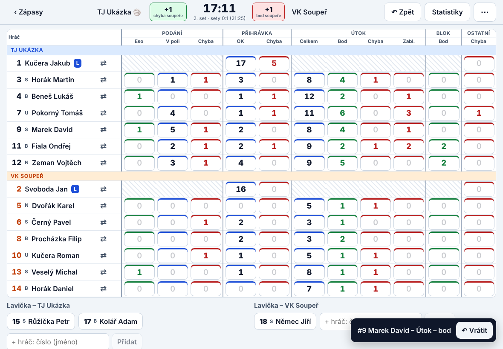
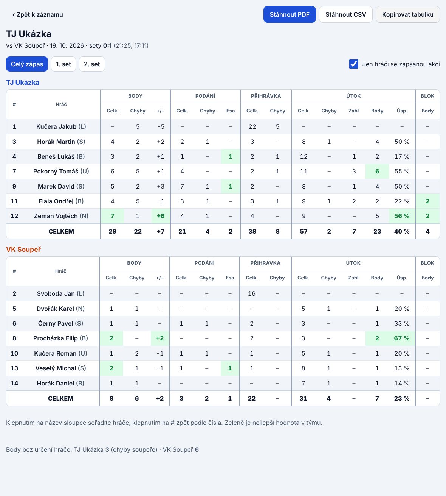
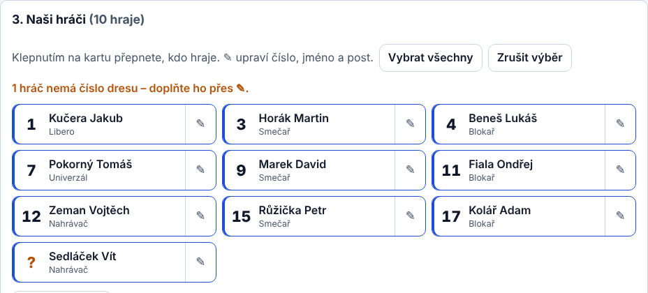
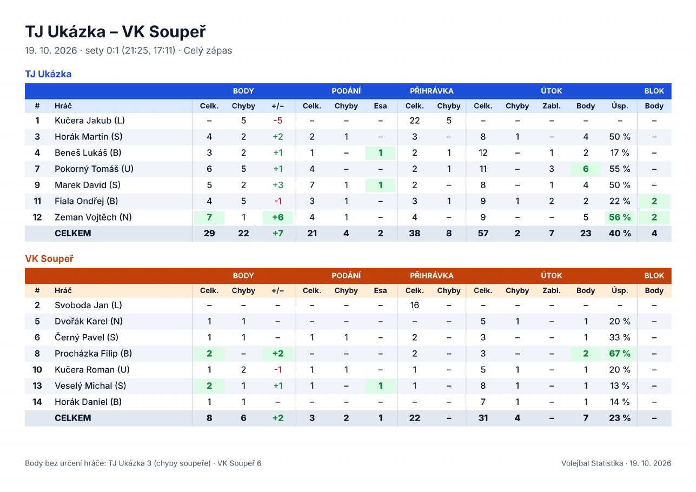

# Volejbal Statistika

[](https://github.com/Jakubko013/volleyball-stat/actions/workflows/ci.yml)

Aplikace pro zápis volejbalové statistiky přímo během zápasu. Navržená pro iPad u lavičky: jedno klepnutí = jedna akce, funguje i bez internetu a soupisky si sama stáhne z webu Českého volejbalového svazu.

> **In English:** An offline-first volleyball scouting app for tablets. React + TypeScript PWA that also ships as an Android app (Capacitor) and a Windows app (Electron) from one codebase. Rosters are scraped from the Czech Volleyball Federation website, every action is one tap, and match stats export to PDF/CSV.

| Zápis zápasu | Statistiky |
| --- | --- |
|  |  |

| Soupiska | Export do PDF |
| --- | --- |
|  |  |

*Snímky používají smyšlená jména z ukázkového zápasu.*

## Co aplikace umí

- **Soupisky z cvf.cz:** seznam soutěží dospělých (Extraliga, 1. a 2. liga muži i ženy) se načítá pro aktuální sezónu, po výběru týmu se stáhne soupiska včetně čísel dresů a postů. Chybějící čísla si aplikace pamatuje pro další zápasy.
- **Zápis jedním klepnutím:** podání (eso, v poli, chyba), přihrávka, útok (celkem, bod, chyba, zablokován), blok a ostatní chyby, pro náš tým i pro soupeře.
- **Skóre a sety se počítají samy:** konec setu podle pravidel (25 bodů, tie-break 15, rozdíl 2), ukazatel podání, vrácení poslední akce.
- **Střídání podle pravidel:** hráč a náhradník tvoří dvojici, smí vystřídat jen tam a zpět, limit 8 střídání na set, libero se nepočítá.
- **Statistiky:** za zápas i po setech, řazení podle sloupců, zvýraznění nejlepších hodnot, export do PDF (sdílení přes WhatsApp, e-mail…), CSV a schránky.
- **Offline:** po prvním otevření funguje bez signálu, data zůstávají v zařízení.
- **Čtyři platformy z jednoho kódu:** web/PWA, iOS/iPadOS, Android a Windows.

## Technologie

- **React 19 + TypeScript** (strict), **Vite**, bez UI knihovny – vlastní CSS s tokeny, světlý i tmavý režim
- **PWA** (vite-plugin-pwa / Workbox) – instalace na plochu a offline režim
- **Capacitor** pro iOS a Android (nativní HTTP a sdílení souborů), **Electron** pro Windows
- **Vitest** pro testy logiky, **GitHub Actions** pro testy a buildy Android/Windows

## Zajímavá řešení

- **Zápas jako seznam akcí (event sourcing).** Ukládají se jen jednotlivé akce; skóre, sety, kdo podává i všechny statistiky se z nich počítají. Díky tomu je vracení akcí triviální a data jsou vždy konzistentní – [`src/stats.ts`](src/stats.ts).
- **Jedna výměna zapsaná z obou stran.** Když se zapíše naše eso i chyba přihrávky soupeře (nebo zablokovaný útok i bodový blok), bod se započítá jen jednou.
- **Pravidla střídání** jako čisté funkce s testy – [`src/subs.ts`](src/subs.ts).
- **Stahování z cvf.cz bez vlastního backendu.** Prohlížeč nesmí cvf.cz volat přímo (CORS), takže web jde přes přepis na Netlify (`public/_redirects`), Windows verze přes hlavní proces Electronu s povolenou jedinou doménou a Android přes nativní HTTP Capacitoru – [`src/cvf.ts`](src/cvf.ts), [`electron/main.cjs`](electron/main.cjs).
- **PDF bez knihovny.** Tabulka se vykreslí do canvasu (česká diakritika bez vkládání fontů) a vloží do ručně sestaveného PDF – [`src/pdf.ts`](src/pdf.ts). Je to malý samostatný modul, který se načte až při exportu.
- **Rozložení pro iPad:** oba týmy (2 × 7 hráčů) se vejdou bez posouvání i na iPadu mini, na šířku i na výšku.
- **Přístupnost:** popisky pro čtečky obrazovky, viditelný fokus, dotykové cíle, respektování „omezit pohyb“.

## Spuštění

```bash
npm install
npm run dev      # http://localhost:5173 (stahování z cvf.cz jde přes proxy dev serveru)
npm test         # testy logiky (skóre, statistiky, střídání, parsování cvf.cz, PDF)
npm run build    # produkční build PWA do dist/
```

Všechny balíčky jsou v `devDependencies`, protože je Vite zabalí do výsledného buildu; Windows instalátor tak neobsahuje zbytečné `node_modules`.

## Struktura

| Soubor | Účel |
| --- | --- |
| `src/stats.ts` | Akce, skóre, konec setu, kdo podává, výpočet statistik |
| `src/subs.ts` | Pravidla střídání |
| `src/report.ts` | Tabulka statistik: sloupce, řazení, nejlepší hodnoty, CSV |
| `src/pdf.ts` | Export do PDF |
| `src/cvf.ts` | Soutěže, družstva a soupisky z cvf.cz |
| `src/storage.ts` | Ukládání zápasů a soupisek v zařízení |
| `src/screens/` | Obrazovky: zápasy, nový zápas, zápis, statistiky |
| `electron/` | Windows aplikace |
| `ios/` | iOS/iPadOS projekt pro Xcode (Capacitor) |
| `android/` | Android projekt (Capacitor) |

## Nasazení

### Web / iPad (PWA)

[Netlify](https://www.netlify.com/): `npm run build` a složku `dist` přetáhnout na [app.netlify.com/drop](https://app.netlify.com/drop), nebo propojit repozitář (nastavení je v `netlify.toml`). Soubor `public/_redirects` zajistí proxy `/cvf/*` → `www.cvf.cz`. Při jiném hostingu se adresa proxy nastaví proměnnou `VITE_CVF_PROXY`.

Na iPadu: Safari → Sdílet → Přidat na plochu.

### Android (Google Play)

Build běží v GitHub Actions (`.github/workflows/android.yml`) ručně nebo po pushnutí tagu `v*`. Výstupem je testovací APK a s nastaveným podpisovým klíčem i AAB pro Google Play.

1. Vytvořit podpisový klíč a uschovat ho (bez něj už aplikaci nejde aktualizovat):
   ```bash
   keytool -genkey -v -keystore release.jks -keyalg RSA -keysize 2048 -validity 10000 -alias statistika
   base64 -w0 release.jks   # výstup do secretu ANDROID_KEYSTORE_BASE64
   ```
2. Přidat secrety `ANDROID_KEYSTORE_BASE64`, `ANDROID_KEYSTORE_PASSWORD`, `ANDROID_KEY_ALIAS` a `ANDROID_KEY_PASSWORD`.
3. V [Google Play Console](https://play.google.com/console) založit aplikaci a nahrát AAB.

Lokálně (Android Studio): `npm run android:sync && npx cap open android`.

### iOS / iPadOS (App Store)

Xcode projekt je ve složce `ios/` (Capacitor, Swift Package Manager – bez CocoaPods). Na Macu s Xcode:

```bash
npm ci
npm run build:native && npx cap sync ios
npx cap open ios          # otevře projekt v Xcode
```

V Xcode vyberte v *Signing & Capabilities* svůj tým (stačí i bezplatné Apple ID pro spuštění na vlastním iPadu) a spusťte na simulátoru nebo připojeném zařízení. Pro TestFlight a App Store je potřeba Apple Developer Program.

GitHub Actions (`.github/workflows/ios.yml`) na Macu ověří, že se projekt sestaví (build pro simulátor bez podpisu).

### Windows (.exe)

Build běží v GitHub Actions (`.github/workflows/windows.yml`) a vytvoří instalátor i přenosnou verzi. Lokálně na Windows: `npm run electron:build`, výsledek je v `release/`.
